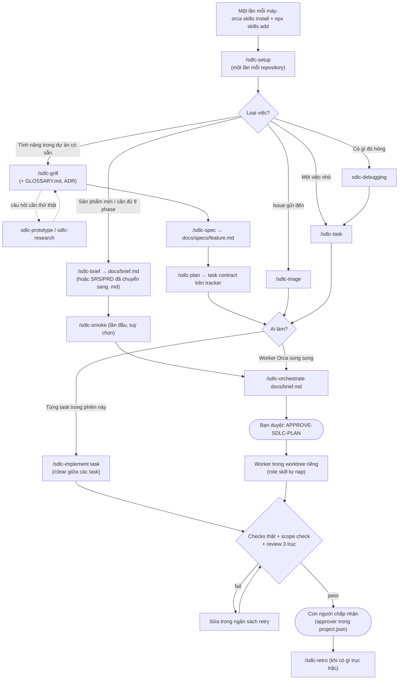

# AI SDLC Core – Reusable Agent Skills Package cho Orca ADE

Một bản **chuẩn, có phiên bản** của toàn bộ tổ chức AI Agent (14 vai trò, 9 workflow SDLC, policy, template,
schema) được đóng gói thành **Agent Skills**. Bạn làm việc hoàn toàn bằng **slash command**; agent tự chạy engine
`sdlc.py`, bạn không cần gõ lệnh Python nào. Phần kỷ luật kỹ thuật (phỏng vấn theo vòng, ngôn ngữ miền, TDD tại
test seam, chẩn đoán lỗi, review ba trục, cắt task kiểu tracer bullet, retro) được học và chuyển thể từ
[mattpocock/skills](https://github.com/mattpocock/skills), rồi gắn vào cơ chế task contract, tracker và Orca của gói này.

Với mỗi repository mới: **cài Skill → `/sdlc-setup` → `/sdlc-help` để chọn luồng**.

Repo này **không** phải plugin Orca tự chạy và không cung cấp AI model. Engine **không bao giờ** tạo Run/Task/worker;
mọi thay đổi trạng thái Orca do Orchestrator thực hiện sau khi con người phê duyệt.

## Mô hình ba lớp

| Lớp | Trách nhiệm | Nằm ở đâu |
|---|---|---|
| **AI SDLC Core** | Một phiên bản chuẩn của agents, workflows, policies, templates, schemas, prompt, engine `sdlc.py` | Skill `ai-sdlc-core` + 25 skill `sdlc-*` (thư mục `skills/`) |
| **Orca ADE** | Điều phối Agent: Runs, tasks, supervised workers, Git worktree | Orca runtime + native skill `orca-cli`, `orchestration` |
| **Repository dự án** | Chỉ cấu hình đặc thù: ngôn ngữ, kiến trúc, lệnh test/lint/build, quy tắc coding, phạm vi chức năng, đường dẫn được ghi/bị bảo vệ, người phê duyệt, tracker | `.ai-sdlc/project.json`, khối quản lý trong `AGENTS.md`/`CLAUDE.md`; tài liệu dự án (`docs/brief.md`, `docs/specs/`, `GLOSSARY.md`, `docs/adr/`) |

Thứ tự ưu tiên: chỉ thị con người > bằng chứng repo/CI > **policy của core** > `project.json` (chỉ được *siết chặt*,
không bao giờ cấp quyền) > task spec > workflow/role/skill.

## Bắt đầu nhanh

### 1. Cài Skill (một lần mỗi máy)

```bash
orca skills install --skill orca-cli --skill orchestration          # Orca native skills
npx skills add <git-url-hoac-duong-dan-repo-nay> --skill '*' --global --agent claude-code --agent codex --copy -y
```

Lệnh thứ hai cài toàn bộ 26 skill của gói, cú pháp đã kiểm với `skills@1.7.4`; chạy với `--list` để xem trước.
Nếu không dùng npx, từ bản clone chạy `python skills/ai-sdlc-core/scripts/sdlc.py install` (copy offline vào
`~/.claude/skills` và `~/.agents/skills`). Cần Python 3.10+ trên máy vì agent dùng nó làm engine.

### 2. Dùng trong repository dự án

Mở phiên Claude Code hoặc Codex của repository trong Orca, rồi gõ slash command. Không nhớ lệnh nào thì gõ
`/sdlc-help <tình huống của bạn>`.

| Slash command | Tác dụng |
|---|---|
| `/sdlc-help <tình huống>` | Bản đồ mọi skill và luồng; khi nào nên tiếp tục, `/clear`, handoff, sub-agent hay `/compact` |
| `/sdlc-setup` | Dò stack, phỏng vấn về kiến trúc, lệnh test, quy tắc coding, phạm vi, người phê duyệt, **CLI mặc định/theo role**, issue tracker, nhãn triage; ghi và validate `.ai-sdlc/project.json`, commit sau khi bạn đồng ý |
| `/sdlc-status` | Báo cáo chỉ đọc: core, skill, config, Git baseline, Orca, task, **frontier** (task sẵn sàng làm), Run, lệnh nên dùng tiếp |
| `/sdlc-brief <ý tưởng>` | Phỏng vấn về mục tiêu, người dùng, MVP, tiêu chí thành công, ràng buộc; viết `docs/brief.md` |
| `/sdlc-grill <kế hoạch>` | Phỏng vấn "tra hỏi" đến khi mọi nhánh quyết định được giải quyết; ghi thuật ngữ vào `GLOSSARY.md`, quyết định khó đảo ngược thành ADR |
| `/sdlc-spec` | Tổng hợp cuộc trao đổi thành `docs/specs/<feature>.md` (không hỏi lại, chỉ xác nhận test seam) |
| `/sdlc-plan <spec>` | Cắt spec/brief/SRS thành các task contract dạng **tracer bullet** có cạnh phụ thuộc, duyệt cùng bạn, publish lên tracker |
| `/sdlc-task <mục tiêu>` | Một task contract đã validate và worker spec tự chứa, không dispatch |
| `/sdlc-implement <task>` | Làm **đúng một** task trong phiên này: TDD tại test seam, chạy checks, scope check, review độc lập, commit vào nhánh task |
| `/sdlc-smoke` | Chứng minh điều phối Orca chạy được: giám sát một worker BA, dừng chờ `START-ORCA-SMOKE-TEST` |
| `/sdlc-orchestrate <mục tiêu hoặc file>` | Phiên hiện tại thành Orchestrator: lập DAG (hoặc dùng plan có sẵn), dừng chờ `APPROVE-SDLC-PLAN`, dispatch worker song song, kiểm chứng |
| `/sdlc-triage <yêu cầu>` | Phân loại issue gửi đến trên GitHub/GitLab/Jira: xác minh, hỏi thêm, biến issue đủ rõ thành task contract hoặc đóng có lý do |
| `/sdlc-retro` | Nhìn lại một phiên/Run và đề xuất cải thiện **môi trường** của agent (check tự động, quy tắc, con trỏ điều hướng) |

Các workflow trên đều có `disable-model-invocation: true` (trừ `/sdlc-status`), tức chỉ chạy khi bạn gọi.
`/sdlc-status` và các skill kỷ luật bên dưới thì agent được tự gọi khi phù hợp.

Khi setup, `init` chỉ suy luận ngôn ngữ và lệnh **từ bằng chứng** trong repo (`package.json` scripts, lockfile, `go.mod`,
`Cargo.toml`, `pom.xml`, Gradle, `*.csproj`, cấu hình pytest/ruff/mypy, `Makefile`…). Thiếu lệnh test thì agent hỏi bạn,
không đoán. Nội dung `AGENTS.md`/`CLAUDE.md` sẵn có được giữ nguyên; chỉ khối giữa
`<!-- ai-sdlc-core:begin -->` và `<!-- ai-sdlc-core:end -->` được chèn hoặc cập nhật. Chi tiết:
[ORCHESTRATOR-ACTIVATION](skills/ai-sdlc-core/references/ORCHESTRATOR-ACTIVATION.md), [ORCA-SETUP](skills/ai-sdlc-core/references/ORCA-SETUP.md).

## Luồng xử lý

Có một bước tiên quyết (`/sdlc-setup`), hai luồng chính, vài "lối nhập" đổ vào luồng chính và một bước khép vòng.



### Cần làm gì thì gọi skill nào

| Tình huống | Bạn gọi | Agent làm | Bạn cần làm | Kết quả |
|---|---|---|---|---|
| Máy mới | (lệnh cài ở mục 1) | – | Chạy 2 lệnh cài | 26 skill + skill native của Orca |
| Repository mới | `/sdlc-setup` | Dò stack, hỏi từng vòng, `init`/`validate` | Trả lời, đồng ý commit | `.ai-sdlc/project.json`, khối trong `AGENTS.md`/`CLAUDE.md` |
| Không biết bắt đầu từ đâu | `/sdlc-help <tình huống>` | Đọc trạng thái repo, chỉ luồng phù hợp | Chọn luồng | Lệnh nên gọi tiếp |
| Chưa có tài liệu gì | `/sdlc-brief <ý tưởng>` | Hỏi từng vòng, viết brief theo template | Chốt quyết định, duyệt brief | `docs/brief.md` |
| Có SRS/PRD (Word, PDF) | Chuyển sang Markdown trong repo, rồi `/sdlc-plan <file>` hoặc `/sdlc-orchestrate <file>` | Cắt thành task / chạy đủ phase | Duyệt kế hoạch | Task contract hoặc Run |
| Ý tưởng tính năng còn mơ hồ | `/sdlc-grill <ý tưởng>` | Hỏi theo cây quyết định, kèm đề xuất | Trả lời từng vòng | Hiểu chung; `GLOSSARY.md`, ADR |
| Đã thống nhất, cần tài liệu | `/sdlc-spec` (cùng phiên với grill) | Tổng hợp spec, xác nhận test seam | Duyệt spec | `docs/specs/<feature>.md` |
| Cần chia việc | `/sdlc-plan <spec>` | Cắt tracer bullet, gán owner/reviewer, phụ thuộc, test seam | Duyệt độ mịn và phụ thuộc | Task trên tracker, frontier |
| Làm một task | `/sdlc-implement TASK-NNN` | TDD, checks, scope check, review độc lập, commit | Chấp nhận hoặc yêu cầu sửa | Nhánh `task/...`, handoff, `submitted_for_review` |
| Làm cả kế hoạch song song | `/sdlc-orchestrate` | Dùng task có sẵn, dừng chờ duyệt, dispatch | Gửi `APPROVE-SDLC-PLAN`, quyết định ở gate | Code/tài liệu đã kiểm chứng |
| Issue dồn đống | `/sdlc-triage what needs attention` | Phân loại, tái hiện bug, hỏi thêm | Duyệt từng thao tác ghi lên tracker | Task contract / needs-info / wontfix |
| Bug khó, test chập chờn | (nói "debug ...") | `sdlc-debugging`: vòng phản hồi đỏ trước, rồi giả thuyết | Cung cấp môi trường/artifact nếu cần | Bản sửa + regression test |
| Sau một phiên trục trặc | `/sdlc-retro` | Đề xuất check, quy tắc, con trỏ | Duyệt từng thay đổi | Môi trường tốt hơn cho lần sau |
| Bất kỳ lúc nào | `/sdlc-status` | `doctor`, task, frontier, Run, upgrade | Đọc kết quả | READY/BLOCKED và lệnh tiếp theo |

Chỉ có hai câu phê duyệt cố định cho Orca: `START-ORCA-SMOKE-TEST` (smoke test) và `APPROVE-SDLC-PLAN` (kế hoạch
thật, có thể duyệt một phần: `APPROVE-SDLC-PLAN TASK-001 TASK-002`). Mọi thao tác ghi lên tracker từ xa (tạo issue,
comment, gắn nhãn, đóng) đều hỏi bạn trước.

### Giữ ngữ cảnh đúng lúc

Giữ grill → spec → plan trong **một phiên liền mạch**: plan cần lý lẽ của buổi grill nguyên văn, không phải bản tóm
tắt. Mỗi `/sdlc-implement` bắt đầu sạch (`/clear`) vì task contract đã tự chứa. Cây quyết định đầy đủ (tiếp tục,
`/clear`, handoff, sub-agent, `/compact`) nằm trong
[PHASE-BOUNDARIES.md](skills/sdlc-help/PHASE-BOUNDARIES.md).

## Kỷ luật kỹ thuật bên trong

Các skill "kỷ luật" là skill do model tự gọi (model-invoked): workflow và worker Orca nạp chúng khi cần, bạn cũng có
thể gọi trực tiếp.

| Skill | Làm gì | Được dùng bởi |
|---|---|---|
| `sdlc-grilling` | Phỏng vấn tương tác bằng **question tool**: nhóm 1–3 câu độc lập, lựa chọn có đề xuất hoặc nhập tự do, ghi nhận câu trả lời thực; theo dõi câu đang chờ/chưa chốt; trong worker chuyển cho Orchestrator | brief, setup, grill, task, plan, triage, requirements |
| `sdlc-domain-modeling` | Thách thức thuật ngữ mơ hồ, kịch bản biên, cập nhật `GLOSSARY.md` ngay khi chốt; ADR chỉ khi khó đảo ngược + gây bất ngờ + là đánh đổi thật | grill, brief, system design, triage |
| `sdlc-codebase-design` | Từ vựng deep module (module, interface, depth, seam, adapter, leverage, locality), deletion test, "design it twice" | system design, tdd, plan |
| `sdlc-tdd` | Đỏ → xanh từng lát dọc, chỉ test tại **test seam đã thống nhất** (trường `test_seams` của task), tránh test dính implementation và test lặp lại logic | implementation, testing |
| `sdlc-debugging` | 6 pha: dựng vòng phản hồi **đỏ được** trước khi đoán, thu nhỏ repro, 3–5 giả thuyết kiểm chứng được, đo đạc, sửa kèm regression test, dọn dẹp | implementation, testing, triage |
| `sdlc-research` | Agent nền đọc nguồn gốc (tài liệu chính thức, mã nguồn, spec), ghi file Markdown có trích dẫn | grill, architecture |
| `sdlc-prototype` | Prototype bỏ đi trả lời một câu hỏi: file HTML cho logic/state, hoặc nhiều biến thể UI trên một route | grill, design, requirements |

`sdlc-grilling` chọn tool hỏi đáp thực sự được phép dùng trong phiên (ví dụ `AskUserQuestion`,
`request_user_input` hoặc `request_user_input_async`), theo schema/giới hạn của host. Tool async gửi câu hỏi trước,
nhận câu trả lời sau; agent chỉ tiếp tục phần việc độc lập trong lúc chờ. Lựa chọn mặc định, câu trả lời rỗng và
im lặng không được xem là đồng ý. Câu phụ thuộc chỉ hỏi sau khi tiền đề được chốt; câu trả lời tự do hoặc sửa đổi
được cập nhật vào các quyết định liên quan. Nếu thiếu tool phù hợp, tool bị giới hạn mode/mục đích, hoặc không
nhập được giá trị cần hỏi, agent hỏi qua chat cho phần đó. Các approval triển khai/publish vẫn theo workflow;
chọn một phương án phỏng vấn không thay cho `APPROVE-SDLC-PLAN` hay `START-ORCA-SMOKE-TEST`.

Các role skill mà worker dùng cũng được siết lại:

- `sdlc-implementation` làm **đúng một** task contract, không động vào task anh em, chỉ ghi trong `allowed_paths`.
- `sdlc-code-review` review trên **ba trục tách biệt**, mỗi trục một sub-agent: **Spec** (đúng contract, không lấn phạm
  vi, scope check), **Standards** (quy tắc dự án + danh sách code smell của Fowler) và **Risk** (đúng đắn, bảo mật,
  tương thích, dữ liệu, chất lượng test). Báo cáo không trộn lẫn các trục; có blocker/major ở bất kỳ trục nào thì
  request changes.
- `sdlc-testing` và `sdlc-requirements-analysis` truy vết yêu cầu → tiêu chí → test, tái hiện lỗi bằng lệnh "đỏ".

### Profile chuyên môn của 14 role

Các profile trong [`agents/`](skills/ai-sdlc-core/agents/) quy định đầu vào, phương pháp, sản phẩm bàn giao,
bằng chứng hoàn thành và tình huống cần escalation riêng cho từng vai trò:

| Role | Trọng tâm được bổ sung |
|---|---|
| Orchestrator | Frontier/phụ thuộc, xung đột writer, vòng sửa–review theo budget, đối soát tích hợp |
| Product Manager | Vấn đề trước giải pháp, chất lượng tín hiệu, trade-off ưu tiên và phép đo kết quả |
| Business Analyst | Luật nghiệp vụ, actor/quyền, state/decision table, ngoại lệ và truy vết baseline |
| UI/UX Designer | Journey đầy đủ trạng thái, component/token, tương tác tiếp cận được, giới hạn prototype |
| Software Architect | Miền và ownership, phương án/cost/reversibility, contract và lỗi từng phần |
| Project Manager | Task bám spec, critical dependency, writer dùng chung, ước lượng và thay đổi scope |
| Frontend Developer | State async, khôi phục UI, accessibility/responsive, xác minh kết quả qua API |
| Backend Developer | Auth/tenant, hợp đồng lỗi, transaction/concurrency/idempotency và lỗi dependency |
| Database Engineer | Query plan, lock theo engine, mixed-version migration, reconciliation và recovery |
| QA Engineer | Coverage theo rủi ro, repro, bằng chứng phù hợp từng claim và giới hạn go/no-go |
| Code Reviewer | Ba trục review, nguyên nhân/hậu quả cụ thể, finding có bằng chứng và retest |
| Security Engineer | Threat → control → test, business-logic abuse, exploitability/impact và kiểm tra fix |
| DevOps Engineer | Artifact tái tạo được, plan khác execution, health/stop/recovery và bằng chứng release |
| Technical Writer | Tài liệu theo audience/task, ví dụ đã kiểm tra, version/status và hướng dẫn migration |

Worker đọc thêm [`ROLE-PROFILE-CONTRACT.md`](skills/ai-sdlc-core/references/ROLE-PROFILE-CONTRACT.md) về nguồn
sự thật, phạm vi, bằng chứng và handoff. Các skill dùng chung phân nhánh theo role: task UI, planning hay viết
hướng dẫn không mặc nhiên tạo PRD/SRS mới. Profile là hướng dẫn chuyên môn, không cấp thêm quyền, tool hay KPI.

Phần nâng cấp tham khảo có chọn lọc [agency-agents](https://github.com/msitarzewski/agency-agents/tree/4e3ac3ca6604c75113f52c695dbddcc7af928b46),
giữ 14 role/ID và cơ chế SDLC hiện có. Bảng ánh xạ nguồn, phần áp dụng và phần chủ động loại bỏ nằm trong
[`ROLE-PROFILE-SOURCES.md`](skills/ai-sdlc-core/references/ROLE-PROFILE-SOURCES.md); giấy phép MIT đi kèm gói.

### Cắt task: tracer bullet

[`references/TASK-AUTHORING.md`](skills/ai-sdlc-core/references/TASK-AUTHORING.md) là quy tắc chung cho
`/sdlc-task`, `/sdlc-plan`, `/sdlc-triage` và Orchestrator:

- Mỗi task là một **lát dọc** xuyên qua mọi tầng cần thiết, tự kiểm chứng được, vừa một context window.
- Refactor dọn đường làm trước ("make the change easy, then make the easy change").
- Refactor diện rộng đi theo **expand → migrate theo lô → contract**, để CI luôn xanh.
- `dependencies` chỉ chứa cạnh thật sự chặn; **frontier** là các task `ready` mà mọi phụ thuộc đã `accepted`.
- Tiêu chí nghiệm thu mô tả hành vi quan sát được, dùng thuật ngữ trong glossary, không ghi số dòng.
- Task của role code bắt buộc có `test_seams`.

### Kiểm tra tự động mới của engine

| Kiểm tra | Bắt lỗi gì |
|---|---|
| `sdlc.py scope --task <contract>` | File đã đổi (commit, staged, unstaged, untracked) nằm ngoài `allowed_paths` hoặc chạm protected path. Worker spec chứa sẵn lệnh này |
| `sdlc.py validate --task A --task B ...` | Trùng `task_id`, vòng phụ thuộc; cảnh báo phụ thuộc nằm ngoài tập |
| `validate` một task | Task của frontend/backend/devops thiếu `test_seams` |
| `validate --bundled` | Skill gọi Skill tool tới skill chỉ người dùng gọi được; `disable-model-invocation` lệch với `agents/openai.yaml`; skill thiếu `openai.yaml`; `/sdlc-help` không nhắc tới một skill |

## Tài liệu xuyên suốt dự án và tính năng

Mọi luồng đều áp dụng
[`DOCUMENTATION-CONTINUITY.md`](skills/ai-sdlc-core/references/DOCUMENTATION-CONTINUITY.md), từ project mới đến
feature, bug fix và release. `/sdlc-setup` lập danh mục tài liệu chuẩn tại `docs/documentation-map.md` (hoặc dùng
danh mục hiện có): đường dẫn, owner, trạng thái, revision được review và khoảng trống. Các nhóm PRD/SRS, UI,
kiến trúc/ADR, API/data, glossary, test/truy vết, hướng dẫn sử dụng/vận hành và release notes đều được đánh giá;
nhóm không áp dụng phải có lý do. Repo cũ thiếu baseline có task bổ sung từ hành vi đã xác minh.

Khi thêm tính năng, **feature spec bổ sung cho PRD/SRS; PRD/SRS vẫn phải được cập nhật ở phần bị ảnh hưởng**:

| Bước | Trách nhiệm với tài liệu |
|---|---|
| `/sdlc-grill` → `/sdlc-spec` | Đọc baseline; lập bảng tác động: tài liệu/section, requirement ID, thay đổi hoặc lý do không tác động, owner, cách xác minh |
| `/sdlc-plan`, `/sdlc-task`, `/sdlc-triage` | Giao mọi cập nhật cho task có scope, deliverable và tiêu chí rõ ràng; mỗi contract có `documentation.assessment` và `documentation.updates` |
| Implementation / Orca worker | Cập nhật phần tài liệu được giao; chạy scope và `docs-check`; chuyển tác động ngoài scope về người điều phối |
| QA / review độc lập | Kiểm tra nội dung nhất quán và liên kết nguồn → yêu cầu → tiêu chí → task → test → evidence thật |
| Nghiệm thu feature/release | Đối soát tài liệu đã tích hợp sau mọi task, cập nhật kết quả test/hướng dẫn và xác nhận các approval cần thiết |

Cập nhật/duyệt yêu cầu trước phần code phụ thuộc; evidence cuối cùng được hoàn thiện sau khi chạy test. Các task
cùng sửa một tài liệu chuẩn phải có thứ tự hoặc một owner tích hợp. Giữ requirement ID ổn định, liên kết ID bị
thay thế, ghi revision/change history; approval cũ chỉ có hiệu lực với revision đã duyệt. Không đóng feature khi
còn tài liệu bắt buộc lỗi thời hoặc truy vết bị đứt.

Engine có lệnh chỉ đọc:

```bash
python <core>/scripts/sdlc.py docs-check --task <contract> --base <base-commit>
```

Lệnh kiểm tra các file text đã cam kết cập nhật có tồn tại, có nội dung, thực sự đổi từ base và chứa requirement
ID đã khai báo. Nó **không chứng minh nội dung đầy đủ/đúng** hoặc phát hiện mọi tài liệu bị bỏ sót: reviewer phải
đối chiếu danh mục, tác động, baseline và evidence. Danh sách cập nhật rỗng cần lý do cụ thể hoặc liên kết task
tài liệu chịu trách nhiệm; feature chỉ hoàn tất sau khi các task đó được đối soát.

## Task được lưu ở đâu

Ngay lúc `/sdlc-setup`, bạn chọn **một** issue tracker. Task contract chỉ nằm ở đúng nơi đó, không có bản sao hay
cơ chế đồng bộ. Nếu repo có remote GitHub hoặc GitLab, agent sẽ đề xuất tracker tương ứng.

| `tracker.provider` | Task nằm ở | Công cụ agent dùng |
|---|---|---|
| `local` (mặc định) | `.ai-sdlc/tasks/TASK-NNN.json`, commit cùng repo | – |
| `github` | Mỗi task là một GitHub issue `TASK-NNN: …`, nhãn `sdlc`, `sdlc:<status>`, `role:<owner>` | `gh` |
| `gitlab` | Mỗi task là một GitLab issue, nhãn như GitHub | `glab` |
| `jira` | Mỗi task là một Jira issue trong project `tracker.project` | `orca jira` (kết nối Jira trong Orca) |
| `other` | Theo quy trình bạn mô tả trong `tracker.notes` (Linear, Azure Boards…) | Theo mô tả |

Với tracker từ xa, nội dung issue do `sdlc.py task body` render. Nó gồm phần tóm tắt dễ đọc (tiêu chí, test seam,
phạm vi, checks) và **contract nhúng** giữa hai dòng `BEGIN/END AI-SDLC TASK CONTRACT`. Contract nhúng là nguồn sự
thật: engine validate và render spec trực tiếp từ nội dung issue đọc về. Cách tạo, đọc, đổi trạng thái, comment bằng
chứng và gắn worktree Orca cho từng tracker nằm trong `skills/ai-sdlc-core/references/trackers/<provider>.md`.

`/sdlc-triage` chỉ dùng với tracker từ xa. Issue gửi đến đi qua các trạng thái `needs-triage` → `needs-info` /
`ready-for-agent` / `ready-for-human` / `wontfix`, cộng nhãn loại `bug` / `enhancement`; tên nhãn thật có thể đổi bằng
`tracker.triage_labels`. Issue `ready-for-agent` luôn đi kèm một task contract hợp lệ, có link tới issue gốc. Yêu cầu
tính năng bị từ chối được ghi vào `.out-of-scope/<khái-niệm>.md` để lần sau nhận ra yêu cầu trùng.

## Bên trong `/sdlc-orchestrate`

Orchestrator chạy theo 9 phase của `workflows/manifest.json`, giới hạn trong `sdlc.enabled_phases` của dự án. Nếu
tracker đã có task cho mục tiêu (ví dụ từ `/sdlc-plan`), nó dùng lại làm DAG. Mỗi worker được Orca khởi động với một
spec tự chứa và tự nạp role skill tương ứng.

| Phase | Vai trò chính | Role skill worker dùng | Gate cuối phase (`policies/quality-gates.md`) |
|---|---|---|---|
| 1. discovery | product-manager | `sdlc-requirements-analysis` | Requirement: phạm vi do product owner xác nhận |
| 2. requirements | business-analyst | `sdlc-requirements-analysis` | Requirement: truy vết, tiêu chí đo được |
| 3. design | ui-ux-designer | `sdlc-requirements-analysis` | Design: UX/accessibility |
| 4. architecture | software-architect (+ database-engineer) | `sdlc-system-design` | Design: ADR/API do tech lead duyệt, test seam theo module |
| 5. planning | project-manager | `sdlc-requirements-analysis` | Planning: schema, graph check, owner ≠ reviewer, có `test_seams` |
| 6. development | backend-developer, frontend-developer | `sdlc-implementation` | Implementation: TDD tại seam, checks từ `commands`, `scope` đạt |
| ↳ review độc lập | code-reviewer, security-engineer | `sdlc-code-review`, `sdlc-testing` | Review: ba trục Spec/Standards/Risk, CI xanh |
| 7. testing | qa-engineer | `sdlc-testing` | Test report theo từng tiêu chí nghiệm thu |
| 8. deployment | devops-engineer | `sdlc-implementation` | Release: chỉ `release_environments`, release owner duyệt |
| 9. maintenance | technical-writer | `sdlc-requirements-analysis` | Bàn giao vận hành, backlog tiếp theo |

Với mỗi task, vòng lặp như sau:
1. Orchestrator dispatch worker (code worker dùng worktree riêng).
2. Worker gửi `worker_done`.
3. Orchestrator tự đọc diff, artifact, chạy lại các lệnh trong `commands` và `sdlc.py scope` trong worktree đó.
4. Một worker khác (reviewer) review ba trục.
5. Gate được ghi `pass`, `fail`, `blocked`, `not_run` hoặc `waived`; chỉ người phê duyệt có tên mới được `waived`.
6. Orchestrator cập nhật trạng thái task trên tracker (`in_progress` → `submitted_for_review` → `accepted` hoặc
   `changes_requested`) và comment Run/Task/Dispatch ID thật cùng bằng chứng.
7. Orchestrator release worker, rồi mới mở task phụ thuộc.

Gate cần quyết định của con người sẽ dừng lại hỏi đúng người trong `sdlc.approvers`. Vai trò để `null` thì gate đó bị chặn.
Production không bao giờ được deploy tự động.

## Engine `sdlc.py` (nâng cao: CI, script, gỡ lỗi)

Các workflow skill gọi engine này; bạn chỉ cần dùng trực tiếp khi chạy CI hoặc gỡ lỗi. Python 3.10+, chỉ thư viện chuẩn.
Mọi lệnh nhận `-C <project-dir>` (mặc định thư mục hiện tại).

| Lệnh | Tác dụng |
|---|---|
| `version`, `where [--json]` | Phiên bản và đường dẫn core đã cài (các đường dẫn `agents/...`, `policies/...` trong tài liệu core tính từ đây) |
| `install` | Copy 26 skill vào thư mục skill của agent (offline) |
| `init` | Tạo `.ai-sdlc/project.json`, khối quản lý `AGENTS.md`/`CLAUDE.md`, ignore `.ai-sdlc/runs/` (`--agent`, `--role-agent ROLE=AGENT`, `--role-model ROLE=MODEL[:EFFORT]`, `--tracker`, `--tracker-project`, `--tracker-notes`, `--triage-label ROLE=LABEL`, `--approver ROLE=NAME`, `--dry-run`, `--force`, `--no-detect`, `--no-agent-files`) |
| `validate [--task F ...] [--core-only] [--bundled]` | Kiểm tra toàn vẹn core, config dự án (schema + quy tắc) và task contract (`F` là file JSON hoặc nội dung issue đã tải về); nhiều `--task` thì kiểm tra thêm đồ thị phụ thuộc |
| `doctor [--offline] [--json]` | Kiểm tra sẵn sàng, chỉ đọc; exit 1 khi có FAIL |
| `task new --id --title --role` | Tạo task contract nháp, điền sẵn checks/forbidden actions (và chỗ cho `test_seams` với role code). Tracker `local` ghi vào `.ai-sdlc/tasks/`; tracker khác ghi vào `.ai-sdlc/runs/tasks/` (nháp, chưa publish) |
| `task body --task F [--output F]` | Render nội dung issue có nhúng contract cho tracker từ xa |
| `spec --task F` | Render worker spec tự chứa (role, policy, cấu hình dự án, phạm vi, test seam, lệnh scope check, checks) vào `.ai-sdlc/runs/specs/` |
| `scope (--task F \| --allowed P ...) [--base REF]` | Exit 1 khi có file đổi nằm ngoài phạm vi task hoặc chạm protected path; base mặc định là merge-base với nhánh mặc định |
| `docs-check --task F [--base REF]` | Kiểm tra assessment, file tài liệu cam kết cập nhật và requirement ID; cần review nội dung riêng |
| `activate [--brief F] [--smoke] [--stdout] [--agent claude\|codex\|antigravity\|opencode\|cursor\|opencode2]` | Render prompt kích hoạt Orchestrator; `--agent` chỉ thay CLI mặc định của lần chạy, role đã gán riêng vẫn ưu tiên |
| `smoke spec\|check` | Spec smoke test BA / kiểm tra tĩnh output |
| `upgrade [--dry-run]` | Chuyển `core_version` của dự án lên core đã cài nếu tương thích, làm mới khối quản lý |

## Cấu hình dự án `.ai-sdlc/project.json`

Schema: [`project.schema.json`](skills/ai-sdlc-core/schemas/project.schema.json); ví dụ đầy đủ:
[`examples/project.example.json`](examples/project.example.json).

| Khối | Nội dung |
|---|---|
| `core_version`, `schema_version` | Pin phiên bản core (xem mục Phiên bản) và phiên bản schema cấu hình |
| `project` | `id`, tên, mô tả, nhánh mặc định, ngôn ngữ trả lời |
| `stack` | Ngôn ngữ lập trình, framework, package manager, runtime |
| `architecture` | Kiểu kiến trúc, tóm tắt, tài liệu, component → paths |
| `commands` | `install`, `build`, `lint`, `typecheck`, `test` (bắt buộc), `e2e`, `security` |
| `coding_rules` | Quy tắc coding và file quy tắc (`CONTRIBUTING.md`…); trục Standards của review đọc từ đây |
| `scope` | `in_scope`/`out_of_scope` chức năng, `allowed_paths` (trần ghi), `protected_paths`, `forbidden_actions` bổ sung |
| `sdlc` | Phase/role được bật, người phê duyệt, retry mặc định, môi trường release |
| `tracker` | Nơi duy nhất lưu task: `local`, `github`, `gitlab`, `jira`, `other`; `project`, `notes`; `triage_labels` (tuỳ chọn) |
| `orca` | CLI mặc định `agent` (`claude`/`codex`/`antigravity`/`opencode`/`cursor`/`opencode2`), map tùy chọn `role_agents` và `role_models` (model/effort), chiến lược worktree, số worker song song |
| `extra_policies` | Policy riêng của dự án (chỉ bổ sung ràng buộc) |

Khi chạy `/sdlc-setup`, chọn CLI mặc định rồi chọn dùng chung hay gán riêng theo công việc. Các nhóm công việc
được mở thành role ID đang bật; skill trình bảng đầy đủ role → CLI (gán riêng/kế thừa) để bạn kiểm tra trước
khi ghi. Ví dụ phần `orca` trong [config mẫu](examples/project.example.json) dùng Claude cho BA/review, Codex
cho backend và Antigravity cho frontend; đây là ví dụ phân công, không phải xếp hạng năng lực.

```bash
python skills/ai-sdlc-core/scripts/sdlc.py init --dry-run --agent claude --role-agent backend-developer=codex --role-agent frontend-developer=antigravity
```

Lệnh trên chỉ xem trước, cần thêm các quyết định còn lại của project trước khi init thật. Role chưa gán riêng
kế thừa `orca.agent`; config cũ không có `role_agents` giữ hành vi cũ. Task vẫn ghi role trong `owner_agent` và
`reviewer_agent`; Orchestrator phân giải CLI riêng cho hai role rồi truyền vào Orca `worker-start --agent`.
Smoke dùng cấu hình Business Analyst. Cùng CLI vẫn phải có worker review độc lập với tác giả.

Muốn ghim model cho role đã gán CLI riêng, thêm `--role-model backend-developer=gpt-6.1-sol:high`; spec và prompt
hiển thị model/effort và Orchestrator truyền `worker-start --model/--effort`. Role không ghim giữ model của CLI.
Validation chỉ kiểm tra cấu trúc và CLI có hỗ trợ flag; model ID phải được xác minh trên execution host.

Trước dispatch phải xác minh CLI được bật trên execution host, xác thực, skills và tools phù hợp. Thiếu khả năng
thì báo blocker và xin chọn lại, không tự thay CLI. Setup không khởi chạy worker, không đổi model hay CLI của
phiên hiện tại. `doctor` chưa xác minh đầy đủ khả năng từng CLI; validation chỉ kiểm tra cấu trúc và role hợp lệ.
Chi tiết: [ROLE-ASSIGNMENT.md](skills/ai-sdlc-core/references/ROLE-ASSIGNMENT.md).

Quy tắc bất biến được `validate` cưỡng chế: phải bật `orchestrator`; có developer role thì phải có `code-reviewer`;
có `development` thì phải có `testing`; owner của phase được bật phải được bật; đường dẫn phải tương đối, không `..`;
không còn placeholder `REPLACE`. Protected paths và forbidden actions mặc định của core (`.ai-sdlc/project.json`,
`.github/workflows/**`, `.env*`, khóa/secrets; deploy production, sửa secrets, merge nhánh bảo vệ, force push…)
**luôn** áp dụng; task có `allowed_paths` chạm vào protected path bị từ chối.

## Bản đồ repository

| Đường dẫn | Ý nghĩa |
|---|---|
| `skills/ai-sdlc-core/SKILL.md`, `core.json` | Skill chính và manifest phiên bản (nguồn sự thật duy nhất của version và danh sách skill) |
| `skills/ai-sdlc-core/agents/`, `workflows/` | 14 vai trò + `registry.json`; 9 playbook + `manifest.json` |
| `skills/ai-sdlc-core/policies/`, `templates/`, `schemas/` | Policy, mẫu tài liệu (brief, feature spec, PRD, SRS, PR…), JSON Schema (task, project) |
| `skills/ai-sdlc-core/references/` | Operating contract, handoff, gán role, cắt task, tracker, thiết lập Orca, kích hoạt Orchestrator |
| `skills/ai-sdlc-core/assets/` | Template prompt/spec, khối `AGENTS.md`/`CLAUDE.md`, brief smoke test |
| `skills/ai-sdlc-core/scripts/` | Bootstrap CLI `sdlc.py` + gói `sdlc_core` |
| `skills/sdlc-{help,setup,status,brief,grill,spec,plan,task,implement,smoke,orchestrate,triage,retro}/` | 13 workflow skill (slash command) |
| `skills/sdlc-{grilling,domain-modeling,codebase-design,tdd,debugging,research,prototype}/` | 7 skill kỷ luật (model-invoked) |
| `skills/sdlc-{requirements-analysis,system-design,implementation,code-review,testing}/` | 5 role skill cho worker |
| `skills/*/agents/openai.yaml` | Metadata cho Codex; `allow_implicit_invocation: false` khớp với `disable-model-invocation: true` |
| `.ai-sdlc/project.json` | Repo này cũng được quản lý bằng chính core (dogfooding) |
| `examples/` | Config dự án mẫu, task contract mẫu |
| `tests/` | Unit/integration test cho core và CLI |

## Kiểm chứng

```bash
python skills/ai-sdlc-core/scripts/sdlc.py validate --bundled --task examples/task-auth.json
python -m unittest discover -s tests -v
python skills/ai-sdlc-core/scripts/sdlc.py doctor --offline
```

## Phiên bản (Versioning)

Bản hiện tại là **0.1.6**, chưa phát hành. Phiên bản nằm ở một nơi duy nhất: `skills/ai-sdlc-core/core.json` và
`metadata.version` của mọi `SKILL.md` trong gói; `sdlc.py validate --bundled` buộc các giá trị này khớp nhau.
Mỗi dự án pin `core_version` trong `.ai-sdlc/project.json`. Quy tắc tương thích theo semver:

| Core đã cài so với pin | Kết quả |
|---|---|
| `0.y.z`: cùng `0.y`, bản cài ≥ pin (ví dụ pin 0.1.0, cài 0.1.4) | Tương thích; `upgrade` chuyển pin lên |
| `0.y.z`: khác minor (ví dụ 0.1.x → 0.2.0) | Không tương thích: mỗi minor của 0.x có thể phá vỡ |
| `≥ 1.0.0`: cùng major, bản cài ≥ pin | Tương thích |
| Khác major, hoặc bản cài cũ hơn pin | `validate`/`doctor` báo lỗi, cần cập nhật skill hoặc làm theo ghi chú nâng cấp |

Mỗi bản phát hành không tương thích phải kèm ghi chú nâng cấp trong mục này.

### Nâng cấp 0.1.0 → 0.1.1

Giữ `config_schema_version` là `0.1`; config pin `0.1.0` vẫn tương thích. Task schema bổ sung trường tùy chọn
`documentation`, nên contract cũ vẫn đọc/validate được và có cảnh báo nếu chưa đánh giá tài liệu. Trước khi chạy
hoặc nghiệm thu task cũ, bổ sung assessment/updates, review thay đổi scope/phụ thuộc và cập nhật đúng tracker;
`docs-check` sẽ chặn contract chưa đánh giá. Draft mới chứa placeholder bắt buộc thay bằng quyết định thật.
Không tự sửa config, baseline hay approval của project khi nâng cấp. Cài bản skill mới trước khi dùng luồng này;
`sdlc.py upgrade` chỉ cập nhật pin/managed blocks khi được người dùng cho phép.

### Nâng cấp 0.1.1 → 0.1.2

`sdlc-grilling` chuyển sang phỏng vấn tương tác bằng question tool phù hợp với host. Các skill gọi nó dùng cùng
cơ chế batch/câu trả lời, thay mẫu Markdown cũ; chat là fallback theo khả năng của từng câu hỏi. Không thêm tool
runtime vào Bootstrap CLI, không đổi schema config/task, không tự bật mode hay thay quyền phê duyệt. Cài lại gói
skill `0.1.2` để nhận hành vi mới; project pin cùng dòng `0.1.x` vẫn tương thích.

### Nâng cấp 0.1.2 → 0.1.3

Thêm `orca.role_agents` tùy chọn, `init --role-agent ROLE=AGENT`, và nhận `antigravity` cùng `claude`/`codex`.
Giữ config schema `0.1`: config cũ vẫn hợp lệ và kế thừa CLI mặc định. Cài core/skills `0.1.3` trước khi dùng
trường mới; engine cũ chưa nhận map này. `/sdlc-setup` hỏi lựa chọn khi tạo project mới, không tự sửa config
project đã có; thay đổi config hiện hữu cần được người dùng cho phép, không dùng `init --force` chỉ để thêm map.
Không thêm runtime dispatcher vào Bootstrap CLI và không tự thay đổi cấu hình Orca/model/quyền.

### Nâng cấp 0.1.3 → 0.1.4

Nâng cấp phương pháp và tiêu chí hoàn thành của 14 role, thêm hợp đồng thực thi chung và định tuyến artifact
trong các skill dùng chung. Giữ config/task schema, role ID, primary skill, CLI routing và approval gate hiện có;
project pin cùng dòng `0.1.x` vẫn tương thích. Cài lại core cùng toàn bộ bundled skills `0.1.4`, rồi render lại
activation/worker specs để có các reference mới; không tự sửa config hay thay đổi trạng thái task đang chạy.
Các năng lực, phương án và ví dụ trong profile chỉ áp dụng theo scope/requirement đã được giao.

### Nâng cấp 0.1.4 → 0.1.5

Thêm `opencode` vào `orca.agent`, `orca.role_agents`, `init --agent`/`--role-agent` và `activate --agent`.
Schema vẫn là `0.1`; cấu hình cũ và quy tắc ưu tiên theo role giữ nguyên. Cài lại toàn bộ bundled skills
`0.1.5` vào các thư mục provider đang dùng, rồi chạy `sdlc.py upgrade` trong dự án cần nâng pin.
Ví dụ xem trước: `sdlc.py init --dry-run --agent codex --role-agent backend-developer=opencode`.
Hỗ trợ cấu hình/render được kiểm chứng bằng `tests/test_agent_routing.py`; không đồng nghĩa đã kiểm chứng
worker OpenCode trong Orca. Trước dispatch, xác minh agent ID, xác thực, skills, tools và lifecycle trên
execution host theo [ROLE-ASSIGNMENT.md](skills/ai-sdlc-core/references/ROLE-ASSIGNMENT.md).

### Nâng cấp 0.1.5 → 0.1.6

Thêm `orca.role_models` tùy chọn (`{model, effort?}` theo role) và `init --role-model ROLE=MODEL[:EFFORT]`; role
được ghim phải có `orca.role_agents` riêng. Nhận thêm agent ID Orca `cursor` và `opencode2`. Phát hiện stack ghi
framework `flutter`, `react-native`, `expo` và dự án Rive (`rive.yaml` ở gốc hoặc thư mục cấp 1) với lint
`rive <dir> --verify`; profile UI/UX và Frontend hướng dẫn làm chuyển động mobile bằng Rive CLI, mọi thao tác chạm
tài khoản Rive (`login`, `push`, `--publish`…) cần người duyệt. Schema vẫn là `0.1`; config cũ hợp lệ nguyên trạng.
Cài lại toàn bộ bundled skills `0.1.6`, rồi `sdlc.py upgrade` trong dự án cần nâng pin. Kiểm chứng bằng
`tests/test_agent_routing.py` và `tests/test_bootstrap.py`; chưa chạy worker Orca thật với `--model`.

## Giới hạn quan trọng

- Git worktree tách nhánh mã nguồn, **không cô lập quyền hệ điều hành/mạng/secrets**.
- Không tự merge/deploy production, xóa dữ liệu, sửa secrets hoặc migration phá hủy.
- LLM review không thay thế CI, test runner, codeowner, branch protection và human approval.
- Quyền thực tế do sandbox/CI/credentials triển khai, **không** do prompt hay `project.json` quyết định.
- `validate`/`scope`/`docs-check`/`smoke check` là kiểm tra tĩnh; Orca không tự đọc `registry.json`/`manifest.json`.
- Đường dẫn core trong prompt/spec là đường dẫn tuyệt đối trên máy sinh ra chúng; sinh lại nếu chuyển máy.

## Ghi công

Các skill `sdlc-grilling`, `sdlc-domain-modeling`, `sdlc-codebase-design`, `sdlc-tdd`, `sdlc-debugging`,
`sdlc-research`, `sdlc-prototype`, `sdlc-grill`, `sdlc-spec`, `sdlc-plan`, `sdlc-implement`, `sdlc-triage`,
`sdlc-retro`, `sdlc-help`, trục Spec/Standards của `sdlc-code-review` và quy tắc cắt task được chuyển thể từ
[mattpocock/skills](https://github.com/mattpocock/skills) (MIT, © 2026 Matt Pocock). Mẫu PR theo dạng "show me" của
Dex Horthy (HumanLayer). Xem [THIRD_PARTY_NOTICES.md](skills/ai-sdlc-core/THIRD_PARTY_NOTICES.md) (đi kèm mọi bản cài).

Các role profile tham khảo và chuyển thể chọn lọc từ
[msitarzewski/agency-agents](https://github.com/msitarzewski/agency-agents/tree/4e3ac3ca6604c75113f52c695dbddcc7af928b46)
(MIT, copyright 2025 AgentLand Contributors). Bản quyền và giấy phép đầy đủ nằm trong cùng third-party notice.
