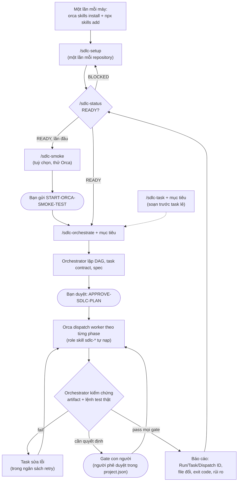

# AI SDLC Core – Reusable Agent Skills Package cho Orca ADE

Một bản **chuẩn, có phiên bản** của toàn bộ tổ chức AI Agent (14 vai trò, 9 workflow SDLC, policy, template,
schema) được đóng gói thành **Agent Skills**. Bạn làm việc hoàn toàn bằng **slash command** (theo phong cách bộ skill
workflow của mattpocock): agent tự chạy engine `sdlc.py`, bạn không cần gõ lệnh Python nào.
Với mỗi repository mới: **cài Skill → `/sdlc-setup` → `/sdlc-orchestrate`**.

Repo này **không** phải plugin Orca tự chạy và không cung cấp AI model. Engine **không bao giờ** tạo Run/Task/worker;
mọi thay đổi trạng thái Orca do Orchestrator thực hiện sau khi con người phê duyệt.

## Mô hình ba lớp

| Lớp | Trách nhiệm | Nằm ở đâu |
|---|---|---|
| **AI SDLC Core** | Một phiên bản chuẩn của agents, workflows, policies, templates, schemas, prompt, engine `sdlc.py` | Skill `ai-sdlc-core`, 5 workflow skill, 5 role skill `sdlc-*` (thư mục `skills/`) |
| **Orca ADE** | Điều phối Agent: Runs, tasks, supervised workers, Git worktree | Orca runtime + native skill `orca-cli`, `orchestration` |
| **Repository dự án** | Chỉ cấu hình đặc thù: ngôn ngữ, kiến trúc, lệnh test/lint/build, quy tắc coding, phạm vi chức năng, đường dẫn được ghi/bị bảo vệ, người phê duyệt | `.ai-sdlc/project.json` (+ task contract trong `.ai-sdlc/tasks/`, khối quản lý trong `AGENTS.md`/`CLAUDE.md`) |

Thứ tự ưu tiên: chỉ thị con người > bằng chứng repo/CI > **policy của core** > `project.json` (chỉ được *siết chặt*,
không bao giờ cấp quyền) > task spec > workflow/role/skill.

## Bắt đầu nhanh

### 1. Cài Skill (một lần mỗi máy)

```bash
orca skills install --skill orca-cli --skill orchestration          # Orca native skills
npx skills add <git-url-hoac-duong-dan-repo-nay> --skill '*' --global --agent claude-code --agent codex --copy -y
```

Lệnh thứ hai cài toàn bộ 11 skill của gói, cú pháp đã kiểm với `skills@1.7.4`; chạy với `--list` để xem trước.
Nếu không dùng npx, từ bản clone chạy `python skills/ai-sdlc-core/scripts/sdlc.py install` (copy offline vào
`~/.claude/skills` và `~/.agents/skills`). Cần Python 3.10+ trên máy vì agent dùng nó làm engine.

### 2. Dùng trong repository dự án

Mở phiên Claude Code hoặc Codex của repository trong Orca, rồi gõ:

| Slash command | Tác dụng |
|---|---|
| `/sdlc-setup` | Agent dò stack từ repo, phỏng vấn bạn theo từng vòng (câu hỏi đánh số, kèm đề xuất) về kiến trúc, lệnh test, quy tắc coding, phạm vi, người phê duyệt; ghi và validate `.ai-sdlc/project.json`, commit sau khi bạn đồng ý |
| `/sdlc-status` | Báo cáo chỉ đọc: core, skill, config, Git baseline, Orca, task, Run đang chạy, và lệnh nên dùng tiếp theo |
| `/sdlc-smoke` | Chứng minh điều phối Orca chạy được: giám sát một worker BA, dừng chờ `START-ORCA-SMOKE-TEST` |
| `/sdlc-task <mục tiêu>` | Tạo một task contract đã validate và worker spec tự chứa, không dispatch |
| `/sdlc-orchestrate <mục tiêu hoặc file brief>` | Phiên hiện tại trở thành Orchestrator: lập DAG, dừng chờ `APPROVE-SDLC-PLAN`, rồi dispatch, theo dõi, kiểm chứng worker |

Ví dụ: `/sdlc-orchestrate Thêm đăng nhập bằng email cho API đơn hàng`.

Các workflow có tác dụng thay đổi (`setup`, `task`, `smoke`, `orchestrate`) có `disable-model-invocation: true`, tức
chỉ chạy khi bạn gọi. `/sdlc-status` thì agent được tự gọi khi bạn hỏi kiểu "AI SDLC đã sẵn sàng chưa?".

Khi setup, `init` chỉ suy luận ngôn ngữ và lệnh **từ bằng chứng** trong repo (`package.json` scripts, lockfile, `go.mod`,
`Cargo.toml`, `pom.xml`, Gradle, `*.csproj`, cấu hình pytest/ruff/mypy, `Makefile`…). Thiếu lệnh test thì agent hỏi bạn,
không đoán. Nội dung `AGENTS.md`/`CLAUDE.md` sẵn có được giữ nguyên; chỉ khối giữa
`<!-- ai-sdlc-core:begin -->` và `<!-- ai-sdlc-core:end -->` được chèn hoặc cập nhật. Chi tiết:
[ORCHESTRATOR-ACTIVATION](skills/ai-sdlc-core/references/ORCHESTRATOR-ACTIVATION.md), [ORCA-SETUP](skills/ai-sdlc-core/references/ORCA-SETUP.md).

## Luồng xử lý

### Toàn trình: từ máy mới đến tính năng hoàn thành



### Cần làm gì thì gọi skill nào

| Thời điểm | Bạn gọi | Agent làm | Bạn cần làm | Kết quả |
|---|---|---|---|---|
| Máy mới | (lệnh cài ở mục 1) | – | Chạy 2 lệnh cài | 11 skill + skill native của Orca |
| Repository mới | `/sdlc-setup` | Dò stack, hỏi từng vòng, chạy `init`/`validate` | Trả lời câu hỏi, đồng ý commit | `.ai-sdlc/project.json`, khối trong `AGENTS.md`/`CLAUDE.md` |
| Bất kỳ lúc nào | `/sdlc-status` | `doctor`, liệt kê task, Run, đề xuất upgrade | Đọc kết quả | READY/BLOCKED và lệnh nên dùng tiếp |
| Lần đầu dùng Orca trên repo | `/sdlc-smoke` | Giám sát 1 worker BA, chấm kết quả | Gửi `START-ORCA-SMOKE-TEST` | Bằng chứng Orca chạy được (ID thật) |
| Muốn soạn trước một việc nhỏ | `/sdlc-task <mục tiêu>` | Soạn task contract, validate, render spec | Duyệt owner, phạm vi, tiêu chí | `.ai-sdlc/tasks/TASK-NNN.json`, spec trong `.ai-sdlc/runs/specs/` |
| Có tính năng, bug, mục tiêu cần làm | `/sdlc-orchestrate <mục tiêu>` | Đóng vai Orchestrator: lập kế hoạch rồi dừng | Gửi `APPROVE-SDLC-PLAN`, quyết định ở các gate | Code, tài liệu, kết quả kiểm thử đã kiểm chứng |
| Sau khi cài bản core mới | `/sdlc-status` | Phát hiện pin cũ, chạy `upgrade --dry-run` | Đồng ý upgrade | Pin mới, khối quản lý được làm mới |

Bạn chỉ có hai câu lệnh phê duyệt cố định: `START-ORCA-SMOKE-TEST` cho smoke test và `APPROVE-SDLC-PLAN` cho kế hoạch thật.
Có thể duyệt một phần, ví dụ `APPROVE-SDLC-PLAN TASK-001 TASK-002`. Không có hai câu này, agent chỉ đọc và đề xuất.

### Bên trong `/sdlc-orchestrate`

Orchestrator chạy theo 9 phase của `workflows/manifest.json`, giới hạn trong `sdlc.enabled_phases` của dự án. Mỗi worker
được Orca khởi động với một spec tự chứa và tự nạp role skill tương ứng. Bạn **không** gọi các role skill này.

| Phase | Vai trò chính | Role skill worker dùng | Gate cuối phase (`policies/quality-gates.md`) |
|---|---|---|---|
| 1. discovery | product-manager | `sdlc-requirements-analysis` | Requirement: phạm vi do product owner xác nhận |
| 2. requirements | business-analyst | `sdlc-requirements-analysis` | Requirement: truy vết, tiêu chí đo được |
| 3. design | ui-ux-designer | `sdlc-requirements-analysis` | Design: UX/accessibility |
| 4. architecture | software-architect (+ database-engineer) | `sdlc-system-design` | Design: ADR/API do tech lead duyệt |
| 5. planning | project-manager | `sdlc-requirements-analysis` | Planning: schema, phụ thuộc không vòng, owner ≠ reviewer |
| 6. development | backend-developer, frontend-developer | `sdlc-implementation` | Implementation: build/lint/typecheck/test từ `commands` |
| ↳ review độc lập | code-reviewer, security-engineer | `sdlc-code-review`, `sdlc-testing` | Review + Security: phát hiện độc lập, CI xanh |
| 7. testing | qa-engineer | `sdlc-testing` | Test report theo từng tiêu chí nghiệm thu |
| 8. deployment | devops-engineer | `sdlc-implementation` | Release: chỉ `release_environments`, release owner duyệt |
| 9. maintenance | technical-writer | `sdlc-requirements-analysis` | Bàn giao vận hành, backlog tiếp theo |

Với mỗi task, vòng lặp như sau:
1. Orchestrator dispatch worker (code worker dùng worktree riêng).
2. Worker gửi `worker_done`.
3. Orchestrator tự đọc diff, artifact và chạy lại các lệnh trong `commands`.
4. Gate được ghi `pass`, `fail`, `blocked`, `not_run` hoặc `waived`; chỉ người phê duyệt có tên mới được `waived`.
5. Orchestrator release worker, rồi mới mở task phụ thuộc.

Gate cần quyết định của con người sẽ dừng lại hỏi đúng người trong `sdlc.approvers`. Vai trò để `null` thì gate đó bị chặn.
Production không bao giờ được deploy tự động.

## Engine `sdlc.py` (nâng cao: CI, script, gỡ lỗi)

Các workflow skill gọi engine này; bạn chỉ cần dùng trực tiếp khi chạy CI hoặc gỡ lỗi. Python 3.10+, chỉ thư viện chuẩn.
Mọi lệnh nhận `-C <project-dir>` (mặc định thư mục hiện tại).

| Lệnh | Tác dụng |
|---|---|
| `version`, `where [--json]` | Phiên bản và đường dẫn core đã cài (các đường dẫn `agents/...`, `policies/...` trong tài liệu core tính từ đây) |
| `install` | Copy 11 skill vào thư mục skill của agent (offline) |
| `init` | Tạo `.ai-sdlc/project.json`, khối quản lý `AGENTS.md`/`CLAUDE.md`, ignore `.ai-sdlc/runs/` (`--approver ROLE=NAME`, `--dry-run`, `--force`, `--no-detect`, `--no-agent-files`) |
| `validate [--task F] [--core-only] [--bundled]` | Kiểm tra toàn vẹn core, config dự án (schema + quy tắc) và task contract |
| `doctor [--offline] [--json]` | Kiểm tra sẵn sàng, chỉ đọc; exit 1 khi có FAIL |
| `task new --id --title --role` | Tạo task contract nháp trong `.ai-sdlc/tasks/`, điền sẵn checks/forbidden actions từ config |
| `spec --task F` | Render worker spec tự chứa (role, policy, cấu hình dự án, phạm vi, checks) vào `.ai-sdlc/runs/specs/` |
| `activate [--brief F] [--smoke] [--stdout] [--agent claude\|codex]` | Render prompt kích hoạt Orchestrator |
| `smoke spec\|check` | Spec smoke test BA / kiểm tra tĩnh output |
| `upgrade [--dry-run]` | Chuyển `core_version` của dự án lên core đã cài nếu tương thích, làm mới khối quản lý |

## Cấu hình dự án `.ai-sdlc/project.json`

Schema: [`project.schema.json`](skills/ai-sdlc-core/schemas/project.schema.json); ví dụ đầy đủ:
[`examples/project.example.json`](examples/project.example.json).

| Khối | Nội dung |
|---|---|
| `core_version`, `schema_version` | Pin phiên bản core (xem mục Phiên bản) và phiên bản schema cấu hình |
| `project` | `id`, tên, mô tả, nhánh mặc định, ngôn ngữ trả lời |
| `stack` | Ngôn ngữ lập trình, framework, package manager, runtime |
| `architecture` | Kiểu kiến trúc, tóm tắt, tài liệu, component → paths |
| `commands` | `install`, `build`, `lint`, `typecheck`, `test` (bắt buộc), `e2e`, `security` |
| `coding_rules` | Quy tắc coding và file quy tắc (`CONTRIBUTING.md`…) |
| `scope` | `in_scope`/`out_of_scope` chức năng, `allowed_paths` (trần ghi), `protected_paths`, `forbidden_actions` bổ sung |
| `sdlc` | Phase/role được bật, người phê duyệt, retry mặc định, môi trường release |
| `orca` | Agent (`claude`/`codex`), chiến lược worktree, số worker song song |
| `extra_policies` | Policy riêng của dự án (chỉ bổ sung ràng buộc) |

Quy tắc bất biến được `validate` cưỡng chế: phải bật `orchestrator`; có developer role thì phải có `code-reviewer`;
có `development` thì phải có `testing`; owner của phase được bật phải được bật; đường dẫn phải tương đối, không `..`;
không còn placeholder `REPLACE`. Protected paths và forbidden actions mặc định của core (`.ai-sdlc/project.json`,
`.github/workflows/**`, `.env*`, khóa/secrets; deploy production, sửa secrets, merge nhánh bảo vệ, force push…)
**luôn** áp dụng; task có `allowed_paths` chạm vào protected path bị từ chối.

## Bản đồ repository

| Đường dẫn | Ý nghĩa |
|---|---|
| `skills/ai-sdlc-core/SKILL.md`, `core.json` | Skill chính và manifest phiên bản (nguồn sự thật duy nhất của version) |
| `skills/ai-sdlc-core/agents/`, `workflows/` | 14 vai trò + `registry.json`; 9 playbook + `manifest.json` |
| `skills/ai-sdlc-core/policies/`, `templates/`, `schemas/` | Policy, mẫu tài liệu, JSON Schema (task, project) |
| `skills/ai-sdlc-core/references/` | Operating contract, handoff, gán role, thiết lập Orca, kích hoạt Orchestrator |
| `skills/ai-sdlc-core/assets/` | Template prompt/spec, khối `AGENTS.md`/`CLAUDE.md`, brief smoke test |
| `skills/ai-sdlc-core/scripts/` | Bootstrap CLI `sdlc.py` + gói `sdlc_core` |
| `skills/sdlc-{setup,status,task,smoke,orchestrate}/` | 5 workflow skill (slash command) + `agents/openai.yaml` cho Codex |
| `skills/sdlc-{requirements-analysis,system-design,implementation,code-review,testing}/` | 5 role skill cho worker |
| `.ai-sdlc/project.json` | Repo này cũng được quản lý bằng chính core (dogfooding) |
| `examples/` | Config dự án mẫu, task contract mẫu |
| `tests/` | Unit/integration test cho core và CLI |

## Kiểm chứng

```bash
python skills/ai-sdlc-core/scripts/sdlc.py validate --bundled --task examples/task-auth.json
python -m unittest discover -s tests -v
python skills/ai-sdlc-core/scripts/sdlc.py doctor --offline
```

## Phiên bản (Versioning)

Bản hiện tại là **0.1.0**, chưa phát hành. Phiên bản nằm ở một nơi duy nhất: `skills/ai-sdlc-core/core.json` và
`metadata.version` của mọi `SKILL.md` trong gói; `sdlc.py validate --bundled` buộc các giá trị này khớp nhau.
Mỗi dự án pin `core_version` trong `.ai-sdlc/project.json`. Quy tắc tương thích theo semver:

| Core đã cài so với pin | Kết quả |
|---|---|
| `0.y.z`: cùng `0.y`, bản cài ≥ pin (ví dụ pin 0.1.0, cài 0.1.4) | Tương thích; `upgrade` chuyển pin lên |
| `0.y.z`: khác minor (ví dụ 0.1.x → 0.2.0) | Không tương thích: mỗi minor của 0.x có thể phá vỡ |
| `≥ 1.0.0`: cùng major, bản cài ≥ pin | Tương thích |
| Khác major, hoặc bản cài cũ hơn pin | `validate`/`doctor` báo lỗi, cần cập nhật skill hoặc làm theo ghi chú nâng cấp |

Mỗi bản phát hành không tương thích phải kèm ghi chú nâng cấp trong mục này.

## Giới hạn quan trọng

- Git worktree tách nhánh mã nguồn, **không cô lập quyền hệ điều hành/mạng/secrets**.
- Không tự merge/deploy production, xóa dữ liệu, sửa secrets hoặc migration phá hủy.
- LLM review không thay thế CI, test runner, codeowner, branch protection và human approval.
- Quyền thực tế do sandbox/CI/credentials triển khai, **không** do prompt hay `project.json` quyết định.
- `validate`/`smoke check` là kiểm tra tĩnh; Orca không tự đọc `registry.json`/`manifest.json`.
- Đường dẫn core trong prompt/spec là đường dẫn tuyệt đối trên máy sinh ra chúng; sinh lại nếu chuyển máy.
