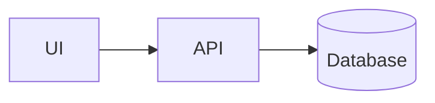

# Architecture & ADR

- **Project ID:**
- **Version / author / reviewer:**
- **Requirement references:**

## Context and constraints
Users, boundaries, existing codebase, NFR targets.

## Options considered
| Option | Benefits | Costs/Risks | Decision |
|---|---|---|---|

## Component diagram

Replace diagram with verified project architecture.

## Data ownership & API contract
Tables/entities, migrations, endpoint schema/versioning, errors, auth scopes.

## Security / privacy / observability
Threat boundaries, sensitive data, logging, metrics, alerting.

## Testing, rollout, rollback
Compatibility, performance testing, deployment strategy, rollback safety.

## ADR decision and sign-off
Decision, tradeoffs, owner, human reviewer, timestamp, review link.
